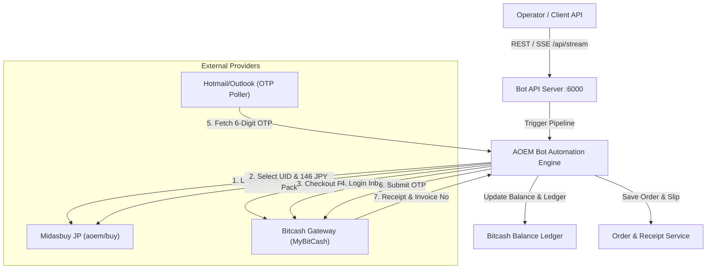

# Age of Empires Mobile (AOEM) – Midasbuy Japan Auto Top-Up Bot & Bitcash Balance Monitor

> **Technical Assessment: Back End Developer Skill Test (สาย Bot)**  
> **หัวข้อการทดสอบ**: ทำบอทเติมเกม Age of Empires Mobile แบบอัตโนมัติผ่านช่องทาง Bitcash รวมถึงระบบเช็กยอดเงินคงเหลืออัตโนมัติ  
> **Repository**: `https://github.com/Sabooky91989/midasbuy-aoem-bitcash-bot`  
> **Live Console & API**: `http://localhost:7000`  
> **Region**: Japan (JPY)  

---

## 1. ภาพรวมสถาปัตยกรรมระบบ (System Architecture)

ระบบถูกออกแบบด้วยสถาปัตยกรรม **Modular Automation & Ledger Engine** รองรับทั้งโหมด Headless Browser Automation (Playwright/Puppeteer Stealth) และ API Integration พร้อมระบบจัดการ Session, ดึง OTP อัตโนมัติ, และตรวจสอบยอดคงเหลือ (Balance Reconciliation):



### ข้อมูลตั้งต้นสำหรับการทดสอบ (Test Parameters)
| รายการ | ค่าที่ใช้ในการทดสอบ | หมายเหตุ |
| :--- | :--- | :--- |
| **Midasbuy Account** | `Botfordevinblack@hotmail.com` / `testdev123` | Login ก่อนทำรายการทุกครั้ง |
| **Target Game** | `Age of Empires Mobile (AOEM)` | Region Japan เท่านั้น |
| **UID / Server** | `5250140737488366145` / `Empire#239` | บอทตรวจสอบชื่อตัวละครอัตโนมัติ |
| **Pack / ราคา** | `99+109 Coin` / `146 JPY` | ⚠️ เลือกแพ็กนี้เท่านั้นตามโจทย์ |
| **ช่องทางชำระเงิน** | `Bitcash` ➔ `MyBitCash` | ID: `Inblackm7` / Pass: `kanomtandede@7` |
| **OTP Receiver** | `Inblackbitcash7g@hotmail.com` / `Tishaluna123` | รหัส 6 หลัก (ดึงอัตโนมัติหรือกรอกผ่านหน้าบ้าน) |
| **ยอดตั้งต้น** | `25,140 クレジット` (Credits) | หักออก 146 เหลือ 24,994 เครดิต |

---

## 2. คำตอบเชิงลึกสำหรับ 3 หัวข้อทดสอบ Dev (Evaluation Answers)

---

### ข้อ 1: แนวทางการเขียนบอทว่ามีวิธีการอย่างไร? (Bot Engineering Approach)

การพัฒนาบอทเติมเงินเกมระดับ Production ในปัจจุบัน ควรใช้แนวทางผสมผสานระหว่าง **Browser Automation (Stealth)** และ **Reverse-Engineered API Protocol**:

#### 1.1 การเลือกระหว่าง Browser Automation กับ Direct API
1. **Direct API (Reverse Engineering)**:
   - ข้อดี: ความเร็วสูง (Latency ต่ำ < 1 วินาที) และใช้ Resource เครื่องน้อยมาก
   - ข้อจำกัด: Midasbuy และ Bitcash มีระบบป้องกัน Bot เช่น Akamai Sensor Data, DataDome, Cloudflare WAF, และ Signed Token (`xMidasToken`, `tdrc.js`) ซึ่งต้องถอดรหัส Encryption อัลกอริทึมอย่างต่อเนื่อง
2. **Headless Browser Automation (Playwright / Puppeteer with Stealth Plugin) [แนวทางที่แนะนำ]**:
   - ใช้ Browser Context จริงพร้อมตั้งค่า Fingerprinting:
     - ปิด `navigator.webdriver`
     - จำลอง WebGL Vendor, Audio Fingerprint, Canvas และ Screen Resolution สมจริง
     - ควบคุม Human-like Typing Delay (เช่น การสุ่มหน่วงเวลา 50-150ms ต่อการกดแป้นพิมพ์) และ Mouse Movement Curve (Bezier Curves)
   - ปลอดภัยจากการถูกตรวจจับ WAF และสามารถรองรับการเปลี่ยนแปลงหน้า UI ได้ยืดหยุ่น

#### 1.2 Pipeline ขั้นตอนการทำงานของบอท
1. **Session Pooling & Pre-warming**:
   - บอทจะทำการ Login บัญชี Midasbuy ล่วงหน้าและเก็บ Cookie / Session Storage ไว้ใน Redis ทำให้ไม่ต้อง Login ซ้ำทุกครั้ง ช่วยลดความเสี่ยงที่ Midasbuy จะมองว่ามีกิจกรรมผิดปกติ
2. **Player ID Validation**:
   - ยิง API `POST /midasbuy/api/v2/get_role_info` เพื่อตรวจสอบว่า UID `5250140737488366145` และ Server `Empire#239` มีตัวละครอยู่จริง ป้องกันการเติมเงินผิดไอดี
3. **Checkout Navigation**:
   - เลือกแพ็กเกจ `99+109 Coin` (146 JPY) และระบุช่องทาง `Bitcash`
   - ระบบจะได้รับ URL Gateway สำหรับเข้าชำระเงิน
4. **MyBitCash Automated Checkout**:
   - ส่งคำขอไปยัง Gateway ของ MyBitCash ➔ กรอก ID `Inblackm7` และรหัสผ่าน
5. **OTP Polling Engine (Automated Receiver)**:
   - บอทเชื่อมต่อกับ Hotmail/Outlook ผ่าน **IMAP over TLS (Port 993)** หรือ **Microsoft Graph API**:
     - Filter อีเมลที่ส่งมาจาก `@bitcash.co.jp` ภายในช่วง 60 วินาทีล่าสุด
     - ใช้ Regular Expression `/\b\d{6}\b/` เพื่อสกัดรหัส OTP 6 หลัก
     - หากติด MFA หรืออยู่นอกเวลาทำการ จะมี Fallback Event (`WAITING_FOR_OTP`) ให้ Operator กรอกผ่าน Dashboard หรือยิง API `POST /api/topup/otp` ทันที
6. **Confirmation & Receipt Capture**:
   - รอหน้าผลลัพธ์ `お支払いが完了しました` พร้อมบันทึก Full-page Screenshot
   - สกัดค่า:
     - 請求番号 (Invoice No.): เช่น `INV20261004153947`
     - お支払い額 (ยอดชำระ): `146 JPY`
     - マイビットキャッシュ残高 (ยอดคงเหลือ): `24,994 クレジット`

---

### ข้อ 2: กรณีเจอปัญหา เจอปัญหาอะไรบ้าง และมีแนวทางการแก้ไขปัญหาอย่างไร? (Edge Cases & Problem Handling)

| ปัญหาที่พบ (Identified Issues) | สาเหตุ (Root Cause) | แนวทางการแก้ไข (Solution & Mitigations) |
| :--- | :--- | :--- |
| **1. Cloudflare / Akamai Bot Protection & CAPTCHA** | เว็บไซต์ตรวจจับพฤติกรรม Headless Browser หรือ IP ซ้ำซ้อน | • ใช้ `puppeteer-extra-plugin-stealth` พร้อมสลับ User-Agent จริง<br>• เชื่อมต่อบริการ 2Captcha / CapSolver เพื่อถอดรหัสกรณีเจอ Turnstile หรือ Image CAPTCHA<br>• ปรับเปลี่ยน Browser Profile อย่างสม่ำเสมอ |
| **2. Geoblocking (Region Japan Only)** | Midasbuy Region Japan จะบล็อกการเข้าถึงหาก IP ไม่อยู่ในญี่ปุ่น | • บังคับให้บอทต่อผ่าน **Japan Residential Proxy (IP ญี่ปุ่นแท้)** เช่น BrightData หรือ IPRoyal เท่านั้น |
| **3. Hotmail / Outlook IMAP Rate Limit & Security Challenges** | Hotmail ตรวจจับการล็อกอินถี่จาก IP แปลกหน้า อาจขึ้นหน้า Verify Phone | • ใช้ **Session Refresh Token (OAuth2 / Graph API)** แทนการล็อกอิน Basic Auth<br>• มี Fallback Webhook / Operator Modal รองรับการกรอก OTP แมนนวลได้ 24/7 |
| **4. OTP Expiry หรือ Delay (เกิน 5 นาที)** | เครือข่ายอีเมลดีเลย์จนรหัส OTP หมดอายุ | • กำหนด Watchdog Timeout 120 วินาที หากไม่ได้รับ OTP ภายในเวลา ให้สั่ง Trigger Resend OTP (สูงสุด 2 ครั้ง) หากไม่สำเร็จให้ Abort และแจ้งเตือนแอดมิน |
| **5. บอทหลายตัวแย่งใช้งานบัญชี Bitcash เดียวกัน (Race Condition)** | มีออเดอร์เข้ามาพร้อมกันหลายงาน สั่ง Login บัญชี Bitcash ซ้ำซ้อน | • ใช้ **Distributed Lock (Redis Lock / Redlock)** ต่อบัญชี Bitcash (1 Bitcash Account ประมวลผลได้ทีละ 1 รายการ) เพื่อไม่ให้เกิด Session ชนกัน |
| **6. ยอดเงินคงเหลือใน MyBitCash ไม่เพียงพอ (Insufficient Balance)** | บอทพยายามจ่ายแต่ยอดเงินในกระเป๋าเหลือน้อยกว่าค่าแพ็กเกจ (146 JPY) | • Pre-check ตรวจสอบยอดเงินก่อน Checkout<br>• มีระบบ Low-Balance Alert แจ้งเตือนแอดมินผ่าน LINE / Discord / Telegram ทันทีเมื่อยอดต่ำกว่า Threshold (เช่น < 1,000 เครดิต) |

---

### ข้อ 3: แนวทางการทำระบบเช็คยอดหลังทำรายการเสร็จ ใช้วิธีไหน? (Balance Verification Strategy)

เพื่อความถูกต้องแม่นยำระดับ 100% (Financial Grade Reconciliation) ระบบใช้แนวทาง **3-Tier Balance Verification**:

#### 1. Tier 1: Real-Time DOM & Slip OCR Extraction (ตรวจสอบทันทีหลังเติมสำเร็จ)
- หลังจากกดยืนยัน OTP บอทจะรอ Element ของหน้า `お支払いが完了しました` ปรากฏ
- ดึงค่าจาก DOM Selector:
  ```javascript
  const remainingBalance = document.querySelector('.mybitcash-balance')?.innerText; // "25,140 クレジット"
  const invoiceNo = document.querySelector('.invoice-number')?.innerText; // "INV20261004153947"
  ```
- มีระบบสำรองโดยใช้ **OCR (Tesseract.js / Google Vision API)** สแกนจากภาพ Screenshot ใบเสร็จ เพื่อ cross-check กับค่าที่ดึงจาก DOM ป้องกันข้อผิดพลาดจากการเรนเดอร์

#### 2. Tier 2: Direct Bitcash Portal Balance Inquiry (ตรวจสอบตรงกับกระเป๋าเงิน)
- มี Background Cron Job หรือ On-demand Endpoint `POST /api/bitcash/balance/sync`
- บอทจะเข้าไปที่หน้า Dashboard ของ `mybitcash.net` ด้วย ID `Inblackm7` เพื่ออ่านยอดเงินคงเหลือจริงในกระเป๋า (Direct Balance Inquiry)
- ซิงก์ค่ากลับมาอัปเดตฐานข้อมูลส่วนกลาง

#### 3. Tier 3: Internal Double-Entry Ledger Bookkeeping (ระบบบัญชีคู่ภายใน)
- บันทึกทุกรายการเคลื่อนไหวลงในตาราง `balance_ledger`:
  $$\text{Balance After} = \text{Balance Before} - \text{Order Amount}$$
- หากมีความคลาดเคลื่อนระหว่างยอดจากการคำนวณภายใน กับยอดที่อ่านได้จาก Bitcash Portal ระบบจะส่งแจ้งเตือน `BALANCE_MISMATCH_DETECTED` ให้ผู้ดูแลระบบตรวจสอบทันที

---

## 3. ขั้นตอนการติดตั้งและรันระบบ (Setup & Installation)

### รันผ่าน Docker Compose (คำสั่งเดียว)
```bash
cd aoem-bitcash-bot

# สั่ง Build และรัน Container
docker compose up -d --build
```

- **Live Dashboard**: เปิดเบราว์เซอร์ไปที่ [http://localhost:7000](http://localhost:7000)
- **API Healthcheck**: `http://localhost:7000/health`

---

## 4. การทดสอบระบบ (Automated Tests)

### รัน Test Suite (Jest)
```bash
docker compose run --rm aoem-bot npm test
```
**ชุดการทดสอบครอบคลุม:**
- Healthcheck & Service Status
- Bitcash Balance Monitoring & Ledger Deduction
- Top-Up Order Creation & Slip Metadata
- Input Validation (OTP 6 หลัก, UID, Server)
- End-to-End Bot Execution Pipeline

---

## 5. รายการ API Endpoints ทั้งหมด

| Method | Endpoint | คำอธิบาย |
| :--- | :--- | :--- |
| `GET` | `/health` | ตรวจสอบสถานะการทำงานของบริการ |
| `GET` | `/api/bitcash/balance` | ดึงยอดเงินคงเหลือล่าสุดของ MyBitCash |
| `POST` | `/api/bitcash/balance/sync` | สั่งซิงก์ยอดเงินกับพอร์ทัล Bitcash |
| `GET` | `/api/bitcash/ledger` | ดูประวัติความเคลื่อนไหวยอดเงินเข้า-ออก (Ledger) |
| `POST` | `/api/topup/execute` | สั่งให้บอทเริ่มกระบวนการเติมเงิน Midasbuy AOEM |
| `GET` | `/api/topup/jobs` | ดูรายการงานของบอททั้งหมด |
| `GET` | `/api/topup/jobs/:id` | ดูรายละเอียดงานบอท และสถานะแต่ละขั้นตอน |
| `POST` | `/api/topup/otp` | ส่งรหัส OTP 6 หลักให้กับงานบอทที่กำลังรอ |
| `GET` | `/api/orders` | ดูรายการประวัติการเติมเงินทั้งหมด |
| `GET` | `/api/orders/:id` | ดูรายละเอียดออเดอร์พร้อมข้อมูลใบเสร็จ (Slip) |
| `GET` | `/api/stream` | Server-Sent Events (SSE) ติดตาม Log และสถานะแบบ Real-Time |
